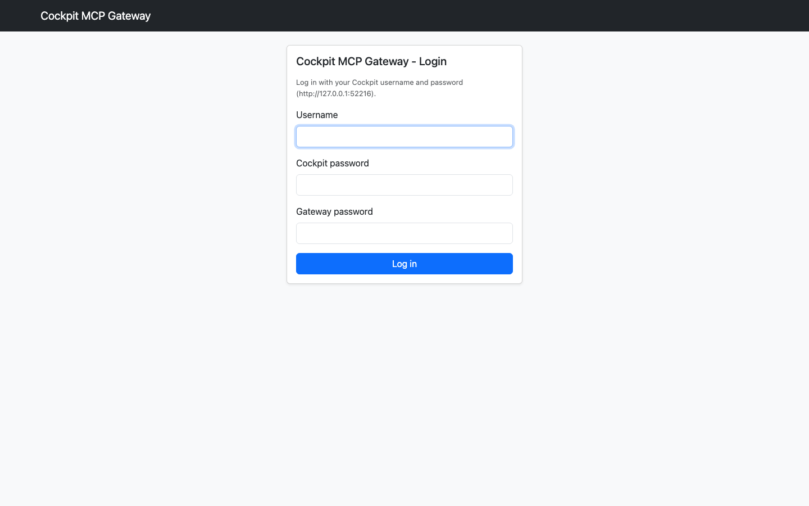
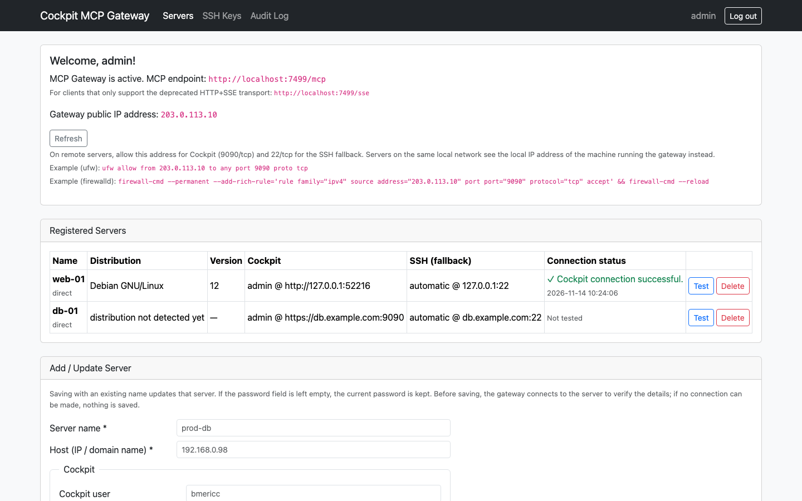
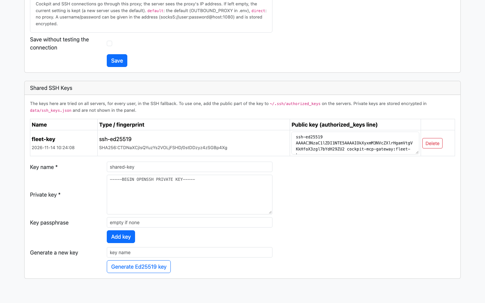
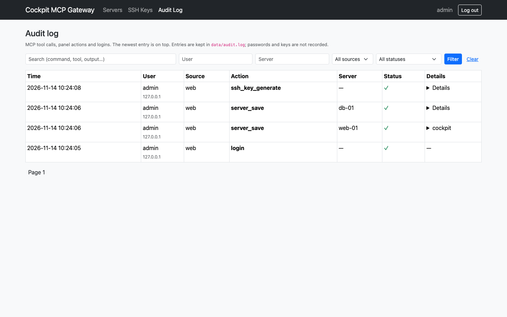

# Feature guide

**English** · [Türkçe](features.tr.md)

[← Back to README](../README.md)

A screen-by-screen tour of the web panel. The screenshots come from a local test setup with sample data (`example.com` hosts, documentation IP addresses).

The panel has three pages in the top menu: **Servers**, **SSH Keys** and **Audit Log**. **Log out** ends the session. The interface follows the browser language: Turkish if the browser prefers it, English otherwise.

## Login

The panel at `https://<PUBLIC_URL>/` asks for three things:

- **Username:** a Cockpit user listed in `ALLOWED_USERS`.
- **Cockpit password:** checked against the Cockpit at `COCKPIT_AUTH_URL`. The page shows which Cockpit that is.
- **Gateway password:** `MCP_API_KEY`. If the address already has `?token=<MCP_API_KEY>`, this field is not shown.

The gateway password is checked first; a wrong one never sends the Cockpit password anywhere. After 10 failed attempts an IP address is blocked for 5 minutes. A panel session lasts 8 hours.

MCP clients that use OAuth (claude.ai) see the same login page while connecting.

## Servers

### Welcome card

- **MCP endpoint:** the address to give MCP clients (`/mcp`, Streamable HTTP), and the `/sse` address for clients that only support the older HTTP+SSE transport.
- **Gateway public IP address:** the address the gateway reaches the internet from. Allow it on the servers for Cockpit (9090/tcp) and SSH (22/tcp); ready-made `ufw` and `firewalld` commands are shown under it. **Refresh** queries it again (it is cached for 10 minutes). If `OUTBOUND_PROXY` is set, the address seen through the proxy is shown too.

### Registered Servers

One row per server:

| Column | Content |
| --- | --- |
| Name | Server name, and its connection proxy (`direct` if none) |
| Distribution, Version | Read from `/etc/os-release`; the package tools use `apt` or `dnf` according to it |
| Cockpit | Cockpit user and address |
| SSH (fallback) | SSH user (`automatic` = `SSH_LOGINS` order) and address |
| Connection status | Result of the last check: ✓ Cockpit, ✓ through the SSH tunnel, ⚠ SSH only (with the reason Cockpit failed), or *Not tested* |

Buttons:

- **Test:** connects now and updates the status.
- **Forget host key:** shown once an SSH host key is pinned. Use it only when the server's key really changed (reinstall); until then, a changed key is refused.
- **Delete:** removes the server after a confirmation.

### Add / Update Server

| Field | Notes |
| --- | --- |
| Server name *, Host * | Required. Saving with an existing name updates that server. |
| Cockpit user / Cockpit password | The account commands run as. Needs `sudo` rights for administrative tools. An empty password keeps the stored one. |
| Cockpit address | `https://HOST:9090` if empty |
| Verify TLS certificate | Leave off for Cockpit's self-signed certificate |
| SSH user / SSH port / SSH key path | Used for the Cockpit tunnel and the SSH fallback |
| Connection proxy | `socks5://host:1080`, `http://host:3128`, `direct` or `default` (`OUTBOUND_PROXY`). Empty keeps the current setting. |
| Save without testing the connection | For a server that is down right now |

**Save** first connects to the server: Cockpit directly, then Cockpit through an SSH tunnel, then plain SSH. If nothing works, nothing is saved and the error is shown. Passwords are stored encrypted with `SECRET_KEY`.

## SSH Keys

Shared keys are tried on every server, for every SSH user, after the user's own `.ssh` keys.

- **Add key:** paste an OpenSSH private key (and its passphrase if it has one).
- **Generate Ed25519 key:** creates a new key pair on the gateway.
- The table shows the type, fingerprint and the **public key line**: add it to `~/.ssh/authorized_keys` on the servers. Private keys are never shown again; they are kept encrypted in `data/ssh_keys.json`.
- **Delete** removes a key after a confirmation.

## Audit Log

Every MCP tool call, MCP connection and panel action is recorded, newest first:

- **Time, User** (with IP address), **Source** (`mcp` or `web`), **Action**, **Server**, **Status**.
- **Details** opens the parameters, the commands run on the server (route, user, exit code) and their output (up to 4000 characters per field).
- Calls refused because `confirm: true` was missing show as *awaiting confirmation*.
- Filter by text, user, server, source and status with **Filter**; **Clear** resets the filters.

Passwords, tokens and private keys are not recorded, but commands and their output are. Entries are kept in `data/audit.log`.

## MCP tools

What an MCP client can do (read tools, changing tools that need `confirm: true`, `MCP_READ_ONLY`) is listed in the README: [MCP tools](../README.md#mcp-tools).
