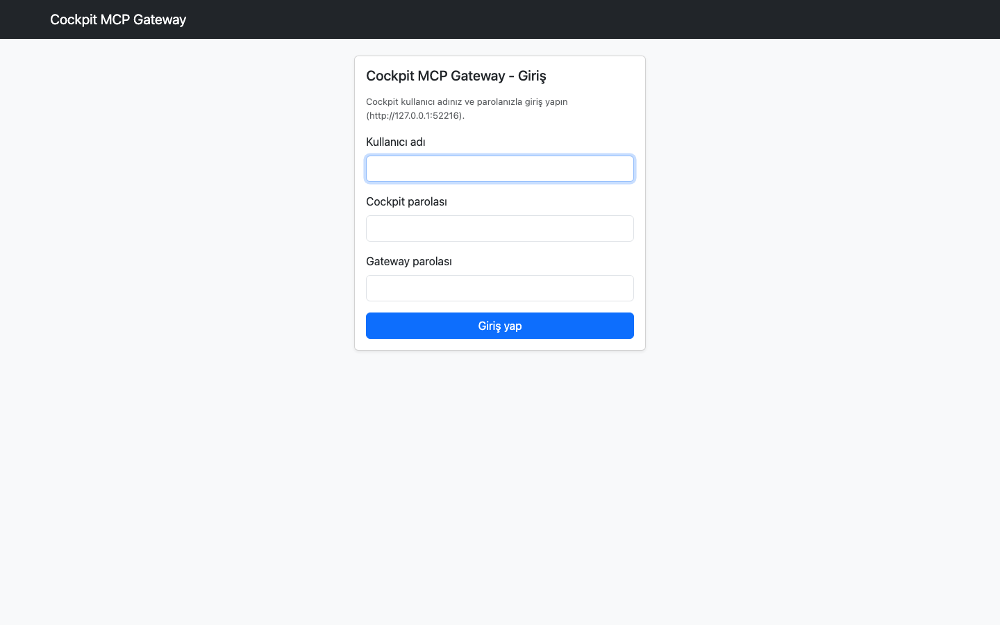
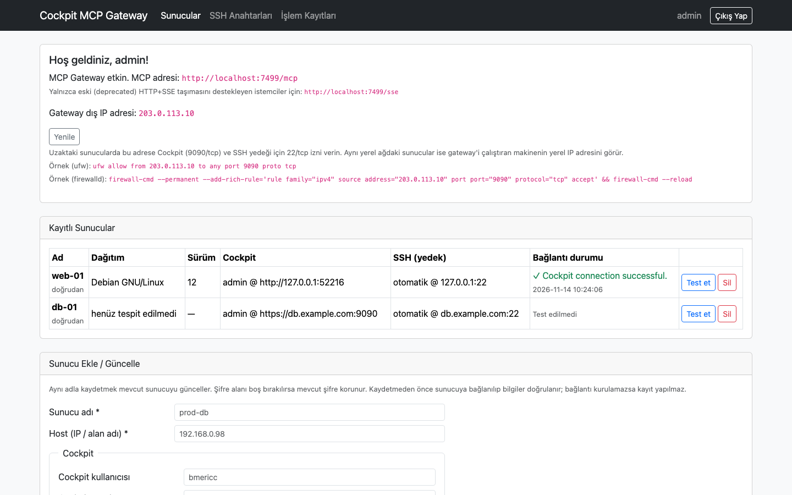
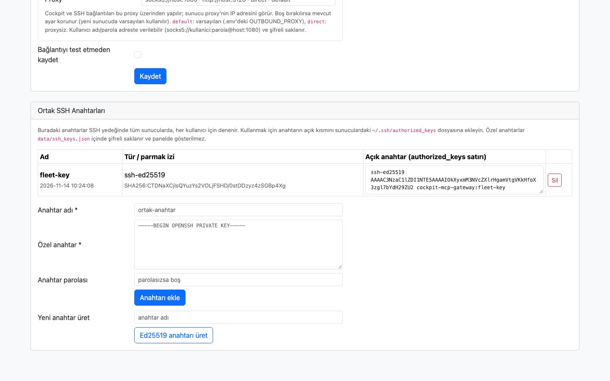
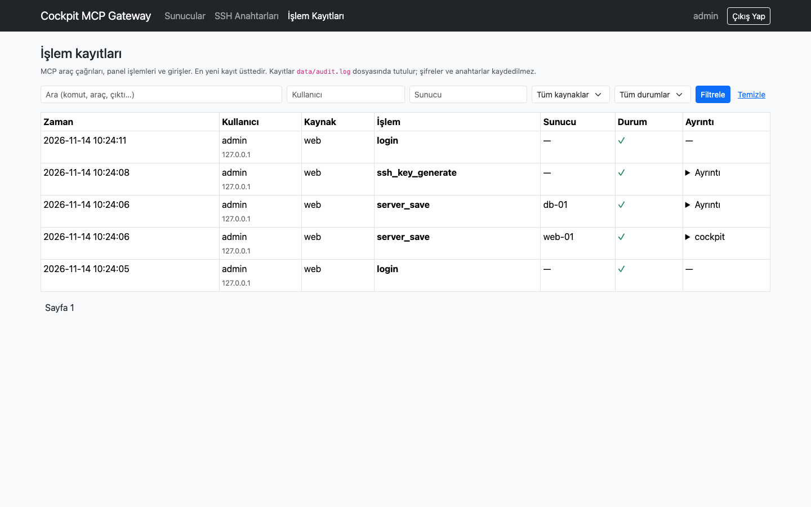

# Özellik rehberi

[English](features.md) · **Türkçe**

[← README'ye dön](../README.tr.md)

Web panelinin ekran ekran tanıtımı. Ekran görüntüleri örnek veriyle (`example.com` sunucuları, belgeleme IP adresleri) kurulmuş yerel bir test ortamından alındı.

Üst menüde üç sayfa var: **Sunucular**, **SSH Anahtarları** ve **İşlem Kayıtları**. **Çıkış Yap** oturumu kapatır. Arayüz tarayıcının diline uyar: tarayıcı Türkçeyi tercih ediyorsa Türkçe, değilse İngilizce.

## Giriş

`https://<PUBLIC_URL>/` adresindeki panel üç şey ister:

- **Kullanıcı adı:** `ALLOWED_USERS`'ta yazan bir Cockpit kullanıcısı.
- **Cockpit parolası:** `COCKPIT_AUTH_URL`'deki Cockpit ile doğrulanır. Hangi Cockpit olduğu sayfada yazar.
- **Gateway parolası:** `MCP_API_KEY`. Adreste zaten `?token=<MCP_API_KEY>` varsa bu alan gösterilmez.

Önce gateway parolası kontrol edilir; yanlışsa Cockpit parolası hiçbir yere gönderilmez. 10 hatalı denemeden sonra IP adresi 5 dakika engellenir. Panel oturumu 8 saat sürer.

OAuth kullanan MCP istemcileri (claude.ai) bağlanırken aynı giriş sayfasını görür.

## Sunucular

### Karşılama kartı

- **MCP uç noktası:** MCP istemcilerine verilecek adres (`/mcp`, Streamable HTTP) ve yalnızca eski HTTP+SSE taşımasını destekleyen istemciler için `/sse` adresi.
- **Gateway dış IP adresi:** gateway'in internete çıktığı adres. Sunucularda Cockpit (9090/tcp) ve SSH (22/tcp) için bu adrese izin verin; altında hazır `ufw` ve `firewalld` komutları yazar. **Yenile** adresi yeniden sorgular (10 dakika önbellekte tutulur). `OUTBOUND_PROXY` tanımlıysa proxy üzerinden görünen adres de gösterilir.

### Kayıtlı Sunucular

Her sunucu için bir satır:

| Sütun | İçerik |
| --- | --- |
| Ad | Sunucu adı ve bağlantı proxy'si (yoksa `doğrudan`) |
| Dağıtım, Sürüm | `/etc/os-release`'ten okunur; paket araçları buna göre `apt` ya da `dnf` kullanır |
| Cockpit | Cockpit kullanıcısı ve adresi |
| SSH (yedek) | SSH kullanıcısı (`otomatik` = `SSH_LOGINS` sırası) ve adresi |
| Bağlantı durumu | Son kontrolün sonucu: ✓ Cockpit, ✓ SSH tüneli üzerinden, ⚠ yalnızca SSH (Cockpit'in neden çalışmadığıyla) ya da *Test edilmedi* |

Butonlar:

- **Test et:** hemen bağlanır ve durumu günceller.
- **Sunucu anahtarını unut:** bir SSH sunucu anahtarı sabitlendiğinde görünür. Yalnızca sunucunun anahtarı gerçekten değiştiyse (yeniden kurulum) kullanın; o zamana kadar değişen anahtar reddedilir.
- **Sil:** onaydan sonra sunucuyu kaldırır.

### Sunucu Ekle / Güncelle

| Alan | Not |
| --- | --- |
| Sunucu adı *, Host * | Zorunlu. Var olan bir adla kaydetmek o sunucuyu günceller. |
| Cockpit kullanıcısı / Cockpit parolası | Komutların çalıştığı hesap. Yönetim araçları için `sudo` yetkisi gerekir. Boş parola kayıtlı olanı korur. |
| Cockpit adresi | Boşsa `https://HOST:9090` |
| TLS sertifikasını doğrula | Cockpit'in kendinden imzalı sertifikası için kapalı bırakın |
| SSH kullanıcısı / SSH portu / SSH key yolu | Cockpit tüneli ve SSH yedeği için |
| Bağlantı proxy'si | `socks5://host:1080`, `http://host:3128`, `direct` ya da `default` (`OUTBOUND_PROXY`). Boşsa mevcut ayar korunur. |
| Bağlantıyı test etmeden kaydet | O an kapalı olan bir sunucu için |

**Kaydet** önce sunucuya bağlanır: doğrudan Cockpit, sonra SSH tüneli üzerinden Cockpit, sonra düz SSH. Hiçbiri çalışmazsa hiçbir şey kaydedilmez ve hata gösterilir. Parolalar `SECRET_KEY` ile şifrelenip saklanır.

## SSH Anahtarları

Ortak anahtarlar her sunucuda, her SSH kullanıcısı için, kullanıcının kendi `.ssh` anahtarlarından sonra denenir.

- **Anahtarı ekle:** bir OpenSSH özel anahtarı (varsa parolasıyla) yapıştırın.
- **Ed25519 anahtarı üret:** gateway'de yeni bir anahtar çifti oluşturur.
- Tabloda tür, parmak izi ve **açık anahtar satırı** görünür: bunu sunuculardaki `~/.ssh/authorized_keys`'e ekleyin. Özel anahtarlar bir daha gösterilmez; `data/ssh_keys.json`'da şifreli tutulur.
- **Sil** onaydan sonra anahtarı kaldırır.

## İşlem Kayıtları

Her MCP araç çağrısı, MCP bağlantısı ve panel işlemi kaydedilir; en yenisi üsttedir:

- **Zaman, Kullanıcı** (IP adresiyle), **Kaynak** (`mcp` ya da `web`), **İşlem**, **Sunucu**, **Durum**.
- **Ayrıntı** parametreleri, sunucuda çalışan komutları (yol, kullanıcı, çıkış kodu) ve çıktılarını (alan başına en fazla 4000 karakter) açar.
- `confirm: true` verilmediği için çalıştırılmayan çağrılar *onay bekliyor* olarak görünür.
- Metin, kullanıcı, sunucu, kaynak ve duruma göre **Filtrele**; **Temizle** filtreleri sıfırlar.

Parolalar, token'lar ve özel anahtarlar kaydedilmez, ama komutlar ve çıktıları kaydedilir. Kayıtlar `data/audit.log`'da tutulur.

## MCP araçları

Bir MCP istemcisinin neler yapabildiği (okuma araçları, `confirm: true` isteyen değiştiren araçlar, `MCP_READ_ONLY`) README'de: [MCP araçları](../README.tr.md#mcp-araçları).
